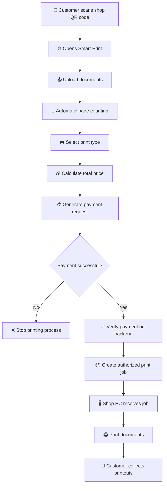
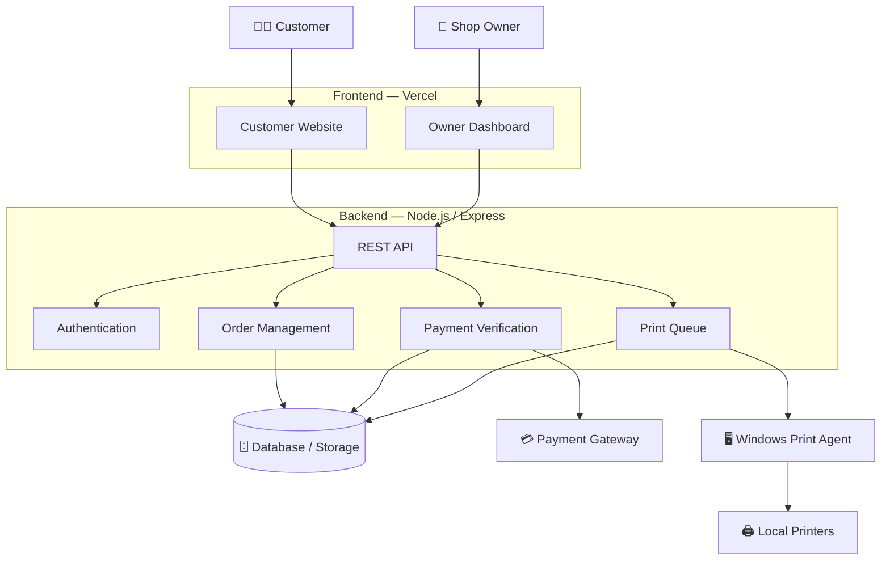
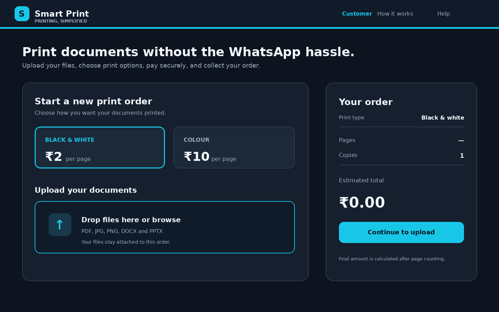
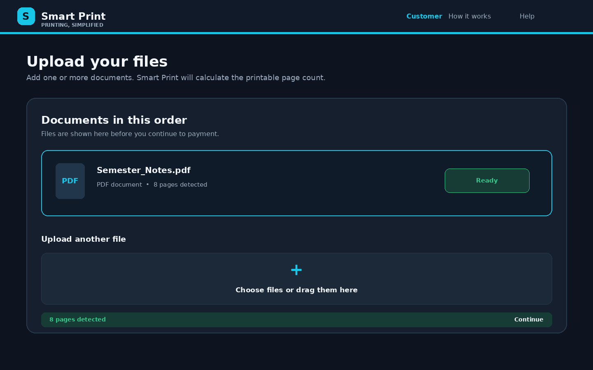
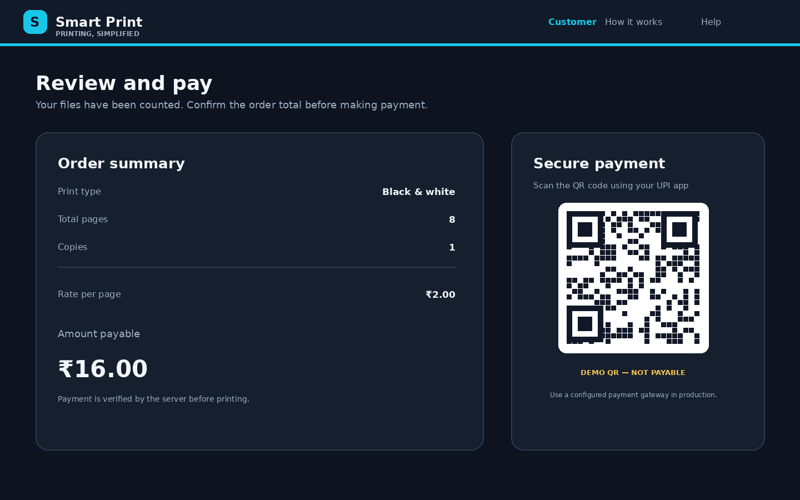
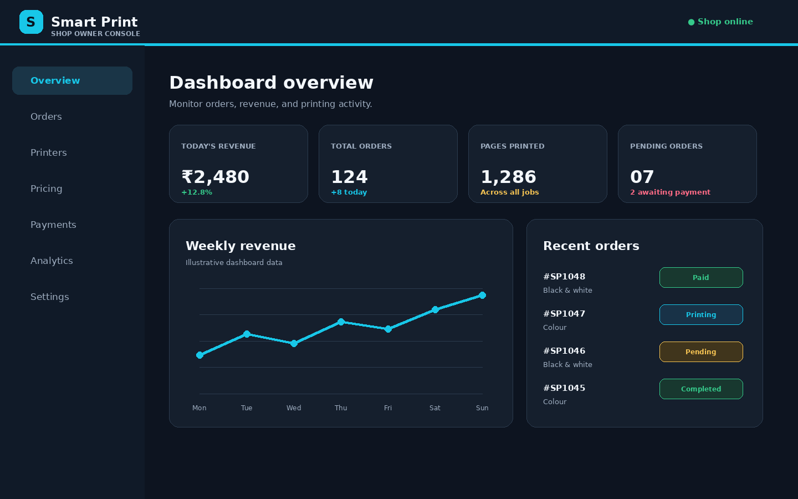

# 🖨️ Smart Print — Intelligent Online Printing & Xerox Management System

<p align="center">
  
</p>

<p align="center">
  <b>Transforming traditional printing shops into smart, automated digital printing stations.</b>
</p>

<p align="center">
  <a href="https://smart-printer.onrender.com">
    
  </a>
  <a href="https://github.com/pranavjadhav1819">
    
  </a>
</p>

<p align="center">
  
  
  
  
  
  
</p>

---

## 🌟 Overview

**Smart Print** is a modern online printing and Xerox management platform designed to simplify the way students, customers, and printing shop owners interact.

Traditionally, customers send documents and photographs through WhatsApp, explain printing requirements, wait for price calculations, make payments manually, and collect their printed documents.

Smart Print transforms this entire process into a streamlined digital workflow.

Customers simply scan a QR code, upload their documents, select printing preferences, pay online, and receive their printouts.

Shop owners can manage orders, configure printing prices, monitor payments, and control connected printers from a centralized dashboard.

> **Our Vision:** Make every traditional Xerox shop smarter, faster, more automated, and digitally connected.

---

## 🚀 Why Smart Print?

Traditional printing shops face several challenges:

| Traditional Process | Smart Print Solution |
|---|---|
| Sending files through WhatsApp | QR-based document uploading |
| Manually counting pages | Automatic page counting |
| Manually calculating prices | Real-time price calculation |
| Manual payment confirmation | Online payment verification |
| Managing multiple customers manually | Digital order management |
| Manually selecting printers | Printer selection and management |
| Searching through WhatsApp files | Centralized order queue |

Smart Print aims to reduce manual work, minimize errors, and improve the customer experience.

---

## ✨ Key Features

### 👨‍🎓 Customer Features

- 📱 QR Code-Based Access
- 📤 Upload multiple documents and photographs
- 📄 Automatic PDF page counting
- 🖨️ Black & White and Colour printing
- 💰 Transparent per-page pricing
- 🔢 Multiple copies support
- 🧮 Automatic order total calculation
- 💳 Online payment integration
- ✅ Payment verification before printing
- 📋 Order status and confirmation
- 🔐 Secure document handling

### 🏪 Shop Owner Features

- 📊 Centralized administration dashboard
- 💵 Configure Black & White printing rates
- 🌈 Configure Colour printing rates
- 📦 Manage incoming print orders
- 💳 Monitor payment status
- 🖨️ Connect multiple printers
- ⚙️ Manage printing operations
- 🟢 Control shop availability
- 📈 View business statistics
- 🗂️ Manage completed and pending orders

### 🖥️ Smart Printing Agent

A lightweight Windows-based printing agent connects the cloud backend with printers installed on the shop computer.

- Connects to the backend using an authentication token.
- Receives authorized print jobs.
- Detects available local printers.
- Sends documents to the selected printer.
- Supports real printer execution.
- Provides a dry-run mode for development and testing.

---

## 🔄 How Smart Print Works

### Complete Customer Workflow



### Example Pricing

| Printing Type | Price Per Page |
|---|---:|
| Black & White | ₹2 |
| Colour | ₹10 |

**Example calculation:**

- Document pages: 20
- Copies: 2
- Total printed pages: 40
- Printing type: Black & White
- Rate: ₹2 per page

**Total amount = 40 × ₹2 = ₹80**

*Actual rates are configurable by the shop owner.*

---

## 🏗️ System Architecture

Smart Print uses a distributed architecture to separate the customer interface, backend processing, database, payment services, and local printing operations.



### Deployment Architecture

| Component | Technology | Hosting |
|---|---|---|
| Customer Website | HTML, CSS, JavaScript | Vercel |
| Owner Dashboard | HTML, CSS, JavaScript | Vercel |
| Backend | Node.js, Express | Render / VPS |
| Database | PostgreSQL / Supabase | Supabase (planned migration) |
| Payment | Razorpay | Razorpay |
| Printing Agent | Node.js | Shop Windows PC |
| Printers | Windows Printer Drivers | Local Shop Network |

---

## 🛠️ Technology Stack

<p align="center">
  
</p>

| Technology | Purpose |
|---|---|
| HTML5 | Website structure |
| CSS3 | Responsive user interface |
| JavaScript | Frontend functionality |
| Node.js | Backend runtime |
| Express.js | API and server |
| QR Code | Customer access |
| Razorpay | Payment gateway integration |
| Vercel | Frontend deployment |
| Render | Backend hosting |
| Git & GitHub | Version control |

---

## 📸 Smart Print — UI Preview Gallery

Explore the Smart Print interface, designed to simplify document printing for customers and shop owners.

### 👨‍🎓 Customer Experience

<table>
<tr>
<td width="50%" align="center">

**1. Customer Homepage**



<sub>Simple printing interface with transparent pricing.</sub>

</td>
<td width="50%" align="center">

**2. Document Upload**



<sub>Upload documents and view page counts.</sub>

</td>
</tr>
<tr>
<td width="50%" align="center">

**3. Secure Payment**



<sub>Review printing costs and proceed to payment.</sub>

</td>
<td width="50%" align="center">

**4. Shop Owner Dashboard**



<sub>Monitor orders, revenue and printing operations.</sub>

</td>
</tr>
</table>

---

### 🚀 Experience Smart Print

<p align="center">
  <a href="https://smart-printer.onrender.com">
    
  </a>
</p>

## ⚙️ Installation & Setup

### Prerequisites

Install the following software:

- Node.js
- npm
- Git
- Windows printer drivers (for actual printing)

### Step 1 — Clone Repository

```bash
git clone https://github.com/pranavjadhav1819/smart-print.git

cd smart-print
```

### Step 2 — Install Dependencies

```bash
npm install
```

### Step 3 — Configure Environment Variables

Create a `.env` file in the backend project root.

```env
PORT=3000

BASE_URL=http://localhost:3000

OWNER_PIN=change_this_secure_pin

AGENT_TOKEN=change_this_secure_token

PAYMENT_MODE=mock

DRY_RUN=1
```

For production, configure the actual backend URL, secure credentials, allowed frontend origin, and payment gateway credentials.

Never upload your `.env` file or secret keys to GitHub.

### Step 4 — Start Backend

```bash
npm start
```

### Step 5 — Start Printing Agent

Open another terminal on the shop computer:

```bash
npm run agent
```

Configure the agent's environment with the backend URL and matching authentication token.

### Step 6 — Open Website

```text
http://localhost:3000
```

Open the owner dashboard and generate your shop's QR code.

---

## ☁️ Deployment Guide

### Frontend — Vercel

1. Push the project to GitHub.
2. Log in to Vercel.
3. Import your GitHub repository.
4. Select the `public` folder as the root directory.
5. Configure the frontend API URL.
6. Deploy the project.

### Backend — Render

1. Create a Render account.
2. Create a new Web Service.
3. Connect your GitHub repository.
4. Set the build command:

```bash
npm install
```

5. Set the start command:

```bash
npm start
```

6. Add production environment variables.
7. Deploy the backend.
8. Configure CORS to allow your Vercel frontend.

### Windows Printing Agent

1. Install Node.js on the shop computer.
2. Download or clone the project.
3. Configure the agent environment.
4. Connect the shop's printers.
5. Test with `DRY_RUN=1`.
6. Set `DRY_RUN=0` only after verifying the printer configuration.
7. Start the agent and test a real print.

**Production warning:** A free hosting service with temporary local storage is not suitable for permanent customer uploads and order records. Use persistent storage and a production database before handling real customer orders.

---

## 💳 Payment Integration

Smart Print is designed to support online payments through Razorpay.

The intended payment process:

1. Customer uploads documents.
2. Backend calculates the payable amount.
3. Backend creates a payment order.
4. Customer completes payment.
5. Backend verifies the payment signature.
6. Backend confirms payment status.
7. Only verified orders enter the print queue.

**Important:** Demo mode uses simulated payments. A live Razorpay integration requires merchant credentials, server-side signature verification, webhook handling, and production testing. Never trust a payment-success response coming only from the customer's browser.

---

## 🔐 Security & Privacy

Security is important because customers upload personal documents.

Smart Print aims to implement:

- Server-side payment verification.
- Authenticated printing agents.
- Secure owner authentication.
- File type and file size validation.
- Restricted upload access.
- Secure document deletion.
- HTTPS communication.
- Environment-based secret management.
- Protection against unauthorized print requests.

Do not expose private customer documents through public URLs.

---

## 🗺️ Project Roadmap

| Feature | Status |
|---|---|
| Customer website | ✅ Initial implementation |
| QR-based file uploading | ✅ Initial implementation |
| Automatic PDF page counting | ✅ Initial implementation |
| Black & White / Colour pricing | ✅ Initial implementation |
| Owner dashboard | ✅ Initial implementation |
| Order queue | ✅ Initial implementation |
| Windows print agent | ✅ Initial implementation |
| Mock payment mode | ✅ Demo support |
| Live Razorpay integration | 🔄 Integration / testing |
| Persistent database migration | 🔄 Planned |
| Advanced analytics dashboard | 🔄 Planned |
| Multiple shops / SaaS accounts | 🔮 Future |
| Customer order tracking | 🔮 Future |
| Mobile application | 🔮 Future |
| Cloud printer management | 🔮 Future |

---

## 🤝 Contributing

Smart Print is an evolving project, and contributions are welcome!

If you are a developer, designer, student, or printing business owner, you can help improve the platform.

### How to Contribute

1. Fork this repository.
2. Create a new branch.
3. Implement your feature or fix.
4. Test your changes.
5. Submit a Pull Request.

```bash
git checkout -b feature/your-feature-name

git add .

git commit -m "Add: your feature description"

git push origin feature/your-feature-name
```

Open a Pull Request with a clear description of your contribution.

### Ideas for Contributors

- Improve UI/UX.
- Add printer compatibility.
- Improve PDF processing.
- Add payment gateway support.
- Improve security.
- Develop analytics.
- Add multilingual support.
- Improve mobile responsiveness.

---

## 💡 Future Vision

Our long-term goal is to develop Smart Print into a scalable digital printing ecosystem.

Imagine a world where:

- Students can print documents from anywhere.
- Shops receive orders automatically.
- Payments are verified instantly.
- Printing is managed through a centralized dashboard.
- Multiple printers operate efficiently.
- Shop owners can monitor revenue and orders.
- Multiple printing shops can use one platform.

**Smart Print is not just a file-upload website. It is a step towards automating the traditional printing industry.**

---

## 👨‍💻 Developer

<p align="center">
  
</p>

<p align="center">
  <b>Pranav Jadhav</b><br/>
  Computer Engineering Student | Web Developer | Programmer
</p>

<p align="center">
  <a href="https://github.com/pranavjadhav1819">
    
  </a>
  <a href="https://www.linkedin.com/in/pranav-jadhav-31006b373/">
    
  </a>
</p>

---

## ⭐ Support the Project

If you find Smart Print useful or interesting:

- ⭐ Star this repository.
- 🍴 Fork the project.
- 🐛 Report bugs.
- 💡 Suggest new features.
- 🤝 Contribute to development.
- 📢 Share it with other developers and printing shop owners.

Your support motivates us to keep improving Smart Print!

<p align="center">
  <a href="https://github.com/pranavjadhav1819/smart-print">
    
  </a>
</p>

<p align="center">
  <b>Built with ❤️ to make printing smarter.</b>
</p>

<p align="center">
  © 2026 Smart Print | Developed by Pranav Jadhav
</p>
